<picture>
  <source media="(prefers-color-scheme: dark)" srcset="assets/header-dark.svg">
  
</picture>

<picture>
  <source media="(prefers-color-scheme: dark)" srcset="assets/lede-dark.svg">
  
</picture>

<picture>
  <source media="(prefers-color-scheme: dark)" srcset="assets/numbers-dark.svg">
  
</picture>

### Currently · DP World

<dl>
<dt>Platform architecture</dt>
<dd>Shaped the platform <strong>from the ground up</strong> across the interface, API layer and backend services, and set the standards the team builds by: shared patterns, design documents, code review and Git practice, mentoring and AI-assisted development.</dd>
<dt>Backend and infrastructure</dt>
<dd>Built and hardened the <strong>Java and Spring services</strong> behind the platform: API contracts, authentication and permissions, bulk data ingestion with partial-failure handling, multi-site work orchestration and a self-hosted map server. Shipped on Kubernetes with CI quality gates, automated releases and an event simulator for end-to-end testing.</dd>
<dt>Applied AI</dt>
<dd>Building <strong>AI decision support</strong> for operations teams, designed so every recommendation is grounded in live operational data and can be traced back to it.</dd>
<dt>Performance</dt>
<dd>Brought page loads from <strong>15 s down to about 1 s</strong>, then applied the same rigour to the backend: leaner search and count queries, static data separated from live data so only what changes is polled, and <strong>API responses 85% smaller</strong>.</dd>
</dl>

### Previously · NammaYatri (Juspay)

Job scheduling at 2M a day, a React Native migration, rider safety and more

<dl>
<dt>Distributed job scheduling</dt>
<dd>Migrated the scheduler to Redis Streams with hybrid DB + Redis storage, 80 parallel channels and an automatic reviver: <strong>up to 2M jobs a day</strong> across 61 job types with <strong>70% lower latency</strong>, scaling from 3K to 200K daily rides with zero job loss.</dd>
<dt>Mobile platform migration</dt>
<dd>Led five engineers moving a PureScript app to React Native with custom Java and Swift native modules: <strong>2× faster builds</strong>, a <strong>40% smaller bundle</strong>, and releases every few weeks instead of every few months.</dd>
<dt>Pickup instructions</dt>
<dd>Full-stack system with geohash-based location mapping, real-time FCM delivery and multi-modal (text + audio) instructions on S3. Handles 30 to 50K instructions a day at sub-2 s latency and <strong>cut pickup cancellations by 5 to 8%</strong> across 200K daily rides.</dd>
<dt>Driver engagement platform</dt>
<dd>Gamification and subscription monetisation with real-time balance updates and atomic concurrency control: <strong>200K+ daily transactions</strong> and <strong>5% lower churn</strong>. Fed by a multi-stream click-attribution pipeline, later extended into event logging and behaviour analytics for 40K+ events.</dd>
<dt>Custom ESLint plugin</dt>
<dd>Enforced functional-programming patterns across 60K+ lines of code. Adopted by 15+ developers on 3 teams, improving type safety by <strong>87%</strong> and cutting <strong>code review time by 40%</strong>.</dd>
<dt>Real-time safety</dt>
<dd>Night-ride monitoring for 60K+ rides a day with route-deviation detection, automated IVR verification and multi-level escalation under 30 s, <strong>reducing safety concerns by 22%</strong>.</dd>
</dl>

### Stack

<picture>
  <source media="(prefers-color-scheme: dark)" srcset="assets/stack-dark.svg">
  
</picture>

### Elsewhere

[Website](https://aman-dwivedi.pages.dev) · [LinkedIn](https://www.linkedin.com/in/dwivediaman) · [Medium](https://aman-dwivedi.medium.com/) · [LeetCode](https://leetcode.com/u/Dwivediaman) · [Stack Overflow](https://stackoverflow.com/users/13461811/confused)
